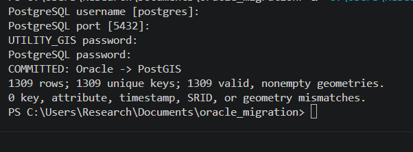
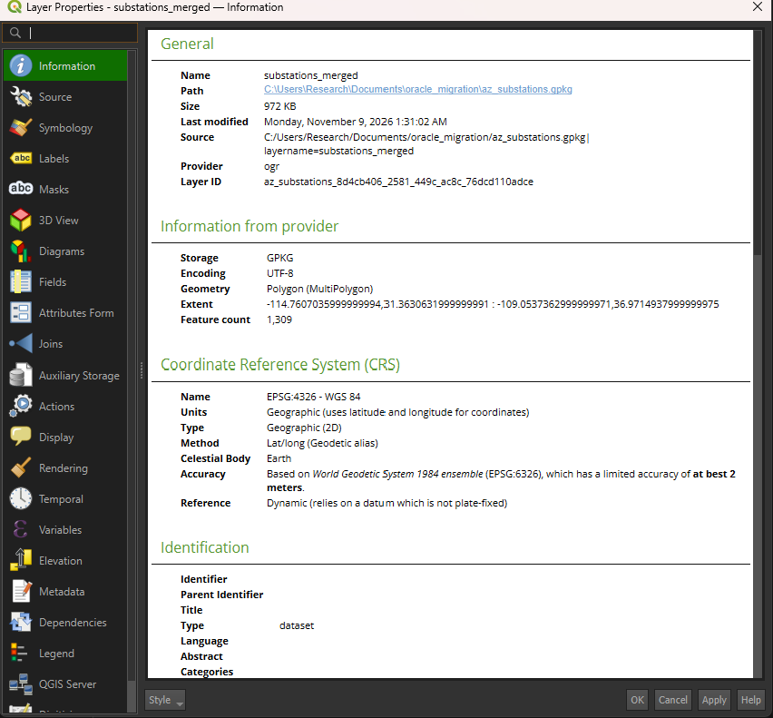
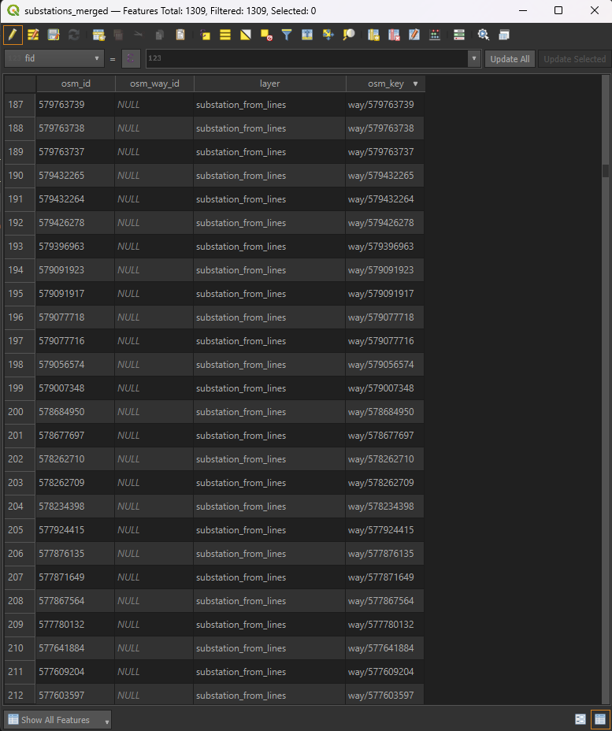
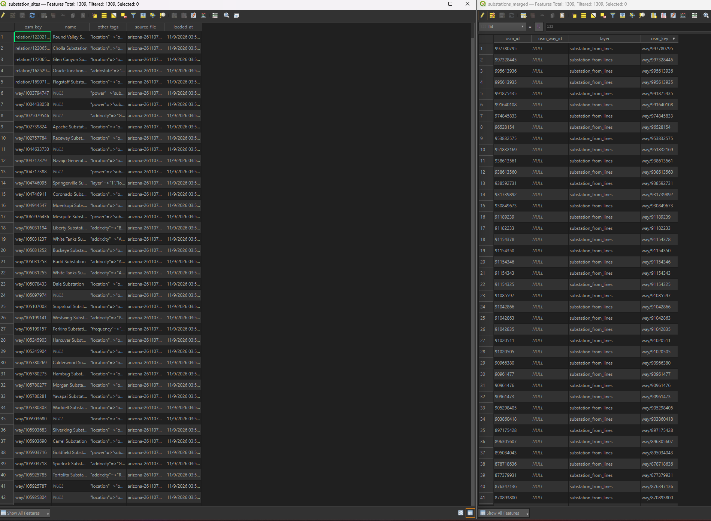

# Oracle Spatial → PostGIS Migration

Migrated **1,309 Arizona substation features** from Oracle Spatial to PostgreSQL/PostGIS using Python and SQL. Prepared the source geometry in QGIS and GDAL/OGR, established stable OpenStreetMap identifiers, and reconciled the destination against an Oracle source snapshot before committing.

**Result:** 1,309 unique records, 1,309 valid nonempty geometries, and zero key, attribute, timestamp, SRID, or geometry mismatches in the Oracle-to-PostGIS transfer.



## Tools and skills

Oracle Spatial · PostgreSQL · PostGIS · Python · SQL · QGIS · GDAL/OGR · ETL · Spatial QA/QC · Schema mapping · Data reconciliation · GeoPackage · GeoJSON · WKB

Python database drivers: `oracledb` and `psycopg`.

## Workflow

1. Extract substation features from an Arizona OpenStreetMap PBF.
2. Inspect geometry classification and recover closed substation outlines stored as lines.
3. Convert closed outlines to polygons and validate both polygon sources.
4. Merge the features and create identifiers that distinguish OSM ways from relations.
5. Load GeoJSON into Oracle as `SDO_GEOMETRY`.
6. Validate the loaded geometry with Oracle Spatial.
7. Transfer directly from Oracle to PostGIS using WKB.
8. Reconcile the destination against the Oracle snapshot, create a spatial index, and inspect the PostGIS layer in QGIS.

## Source preparation: geometry classification matters

The initial `multipolygons` extraction returned only **26 features**. An additional **1,283 substation-tagged features** were present in the OSM driver's `lines` layer.

All 1,283 extracted lines were closed. They were converted individually to polygons using QGIS **Lines to polygons**, then checked with **Check validity → GEOS**.

| Source | Features | Valid | Invalid | Errors |
|---|---:|---:|---:|---:|
| Original polygon extraction | 26 | 26 | 0 | 0 |
| Polygons converted from closed lines | 1,283 | 1,283 | 0 | 0 |
| Combined | **1,309** | **1,309** | **0** | **0** |

This distinguishes **geometry validity** from **extraction completeness**: the original 26 polygons were valid, but inspecting only that layer would have omitted the closed outlines classified as lines.

The resulting merged layer uses **MultiPolygon geometry in EPSG:4326**.



## Stable source identifiers

The two extraction paths stored identifiers differently:

| Source feature | ID field | Key prefix |
|---|---|---|
| Converted OSM way | `osm_id` | `way/` |
| Original polygon representing an OSM way | `osm_way_id` | `way/` |
| Original polygon representing an OSM relation | `osm_id` | `relation/` |

The original 26 polygons comprised **21 ways and 5 relations**. Together with the converted outlines, the merged dataset contained **1,304 ways and 5 relations**.

A QGIS Field Calculator expression populated `osm_key`:

```qgis
CASE
  WHEN "layer" = 'substation_from_lines'
    THEN 'way/' || to_string("osm_id")
  WHEN "osm_way_id" IS NOT NULL
    THEN 'way/' || to_string("osm_way_id")
  ELSE 'relation/' || to_string("osm_id")
END
```

Prefixes prevent a way and relation with the same numeric identifier from being treated as the same object. The source fields were retained in the local merged GeoPackage.



## Database mapping

| Oracle source | PostgreSQL/PostGIS destination | Treatment |
|---|---|---|
| `osm_key VARCHAR2(40 CHAR)` | `osm_key varchar(40)` | Primary key |
| `name VARCHAR2(1000 CHAR)` | `name text` | Preserve values and NULLs |
| `other_tags CLOB` | `other_tags text` | Preserve original tag text |
| `source_file VARCHAR2(100 CHAR)` | `source_file text` | Preserve source filename |
| `loaded_at TIMESTAMP` | `loaded_at timestamp` | Preserve load timestamp |
| `geom SDO_GEOMETRY` | `geom geometry(MultiPolygon,4326)` | WKB transfer; normalize polygon container with `ST_Multi` |

OSM tags remain as HSTORE-formatted **text** in `other_tags`; the destination column is not a PostgreSQL `hstore` column.

The transfer uses `SDO_UTIL.TO_WKBGEOMETRY` in Oracle and `ST_GeomFromWKB` in PostGIS. No coordinate reprojection is performed.

## Validation and reconciliation

Oracle geometry validation used:

```sql
SELECT validity, COUNT(*) AS feature_count
FROM (
    SELECT SDO_GEOM.VALIDATE_GEOMETRY_WITH_CONTEXT(
               s.geom, 0.005
           ) AS validity
    FROM substation_sites s
)
GROUP BY validity
ORDER BY validity;
```

**Observed result:** `TRUE | 1309`.

The migration script checks the following before committing:

- Expected source and destination counts.
- Unique source keys and complete key correspondence.
- Exact preservation of names, tag text, source filenames, and timestamps.
- Source and destination SRID.
- PostGIS geometry validity and absence of empty geometries.
- Binary geometry equality after decoding the Oracle WKB and applying the same MultiPolygon normalization.

Any failed check raises an exception and rolls back the PostgreSQL transaction. A populated destination table causes the script to stop rather than append or overwrite records.

A GiST spatial index is created on the destination geometry column.

| Final check | Result |
|---|---:|
| Migrated records | 1,309 |
| Unique keys | 1,309 |
| Valid nonempty PostGIS geometries | 1,309 |
| Reconciliation mismatches | 0 |



The table comparison documents matching feature counts and access to the destination through QGIS. It is not a spatial alignment measurement.

## Repository contents

| File or folder | Purpose |
|---|---|
| `01_oracle_setup.sql` | Project user creation and grants; password placeholder only |
| `02_connection_check.sql` | Verify Oracle user and database container |
| `03_load_oracle.py` | Check the GeoJSON payload and load Oracle |
| `04_oracle_validation.sql` | Validate Oracle geometry |
| `05_oracle_to_postgis.py` | Direct migration, reconciliation, and spatial indexing |
| `logs/` | QGIS conversion, validation, and merge evidence |
| `images/` | Selected workflow and result screenshots |

Large source files, generated datasets, local QGIS projects, and editor settings are excluded through `.gitignore`.

## Reproducing the workflow

### Requirements

- Oracle AI Database Free with Oracle Spatial available.
- PostgreSQL with PostGIS.
- QGIS and GDAL/OGR with OSM support.
- Python with the database drivers:

```shell
python -m pip install oracledb "psycopg[binary]"
```

Run Python commands using the environment where these packages are installed.

### 1. Prepare the source

Download an Arizona PBF from [Geofabrik](https://download.geofabrik.de/north-america/us/arizona.html). The completed run used `arizona-261107.osm.pbf`, stored locally under `source/`.

From the repository root, run the following commands in a GDAL-enabled shell. These commands use Windows paths.

```bat
ogr2ogr -f GPKG "az_substations.gpkg" "source\arizona-261107.osm.pbf" -dialect SQLite -sql "SELECT * FROM multipolygons WHERE hstore_get_value(other_tags, 'power') = 'substation'" -nln substation_sites -progress
```

```bat
ogr2ogr -f GPKG "az_substation_lines.gpkg" "source\arizona-261107.osm.pbf" -dialect SQLite -sql "SELECT * FROM lines WHERE hstore_get_value(other_tags, 'power') = 'substation'" -nln substation_outlines -progress
```

In QGIS:

1. Confirm the extracted outlines are closed using `is_closed($geometry)`.
2. Convert the outlines with **Lines to polygons**, saving the layer as `substation_from_lines`.
3. Validate both polygon sources with **Check validity → GEOS**.
4. Merge them into `substations_merged` in `az_substations.gpkg`, retaining source information and EPSG:4326.
5. Create a text field named `osm_key` and populate it using the expression above.
6. Check for missing or duplicate keys, save edits, and turn editing off.

Export the payload:

```bat
ogr2ogr -f GeoJSON "substations_oracle.json" "az_substations.gpkg" substations_merged -select osm_key,name,other_tags -lco RFC7946=YES
```

The export uses GDAL's RFC 7946 settings. Its coordinate serialization is therefore part of source preparation; the later zero-mismatch result applies specifically to the Oracle-to-PostGIS transfer.

### 2. Set up and load Oracle

Run `01_oracle_setup.sql` once through an administrator connection to `FREEPDB1`, replacing the password placeholder locally. Do not rerun user creation against an existing project user.

Connect as `UTILITY_GIS`, run `02_connection_check.sql`, then execute:

```shell
python 03_load_oracle.py
```

Keep `substations_oracle.json` beside the loader script. The loader prompts for the Oracle password.

Run `04_oracle_validation.sql` and review the result before migrating.

### 3. Prepare PostgreSQL

Create a database named `utility_migration`. In that database, run:

```sql
CREATE EXTENSION IF NOT EXISTS postgis;
```

### 4. Migrate and verify

```shell
python 05_oracle_to_postgis.py
```

The script prompts for the PostgreSQL username and port, then both database passwords. Passwords are not hard-coded.

Verify the committed destination:

```sql
SELECT
    COUNT(*) AS total,
    COUNT(DISTINCT osm_key) AS unique_keys,
    COUNT(*) FILTER (WHERE ST_IsValid(geom)) AS valid,
    COUNT(*) FILTER (WHERE ST_IsEmpty(geom)) AS empty
FROM public.substation_sites;
```

Expected for the recorded dataset: **1309 | 1309 | 1309 | 0**.

Connect QGIS to `utility_migration` and load `public.substation_sites` for inspection.

## Scope and limitations

This is a local spatial database migration demonstration using public OSM data. It does not establish a complete or authoritative inventory of Arizona substations, survey accuracy, or electrical connectivity.

Names, operators, voltage tags, and other attributes vary in completeness. Missing values are preserved rather than inferred.

The scripts intentionally expect **1,309 features** for this source snapshot. A different extract may require reviewing the expected counts and source-layer classification.

## Data source and attribution

- **Source:** OpenStreetMap Arizona extract distributed by Geofabrik.
- **Recorded source file:** `arizona-261107.osm.pbf`.
- **Download page:** https://download.geofabrik.de/north-america/us/arizona.html
- **Attribution:** © OpenStreetMap contributors.
- **Data license:** [Open Database License (ODbL)](https://www.openstreetmap.org/copyright).

The raw PBF and generated spatial datasets are retained locally and are not included in this repository.